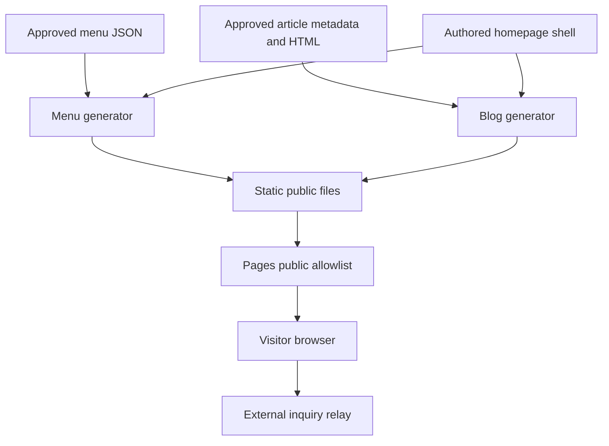

# Architecture and responsibilities

The browser receives static pages, shared CSS/JavaScript and local imagery. Python runs only during maintenance/CI generation. There is no culinary application process or database behind an inquiry.

Text equivalent: approved menu data and article pairs feed separate generators. Both borrow the authored homepage shell. Their static products enter the workflow's public allowlist. Inquiry delivery is an external browser-to-relay path, not a Python server route.

## Responsibility map

| Component | Responsibility | Important coupling |
|---|---|---|
| Home HTML | Factual copy, business schema, form controls, shared chrome | Exact header/footer/sprite patterns feed both generators |
| Menu factory | Full menu page and homepage cards | Full menu links pass a menu id to manually maintained form options |
| Blog factory | Article/index HTML, latest card, RSS and sitemap | Trusted body HTML, UTC date eligibility and existing image paths |
| Browser script | Mobile menu, query preselection, inquiry/fallback/status | Specific DOM ids, CSS `.open`, form field names and provider response shape |
| CSS | Tokens, responsive layout, focus and hidden controls | Mobile navigation needs script to change visibility |
| Offline checker | Current HTML/XML assertions | Does not execute script, generate pages or call external services |
| Workflow | Documentation gate, blog generation, allowlist, Pages | Does not regenerate menus or run the site checker |
| Private documentation check | Portable submitted-index validation before blog build | Generated shared policy bundle, not a chef-site API or independent correctness reviewer |

## Runtime boundaries

The browser may contact Google Fonts and Web3Forms. The business mailbox and DNS are separate operational dependencies. Client-side validation and a honeypot do not create server-side abuse guarantees. [Inquiry and personal data](architecture/inquiry-and-personal-data.md) describes the actual three paths.

The public release copies `blog/` and most `public/assets/` recursively. That is a deliberate shipping boundary, not permission to place private drafts, records or account material there. [Publication review](how-to/review-publication-and-domain-evidence.md) explains exposure.

## Source ownership is more important than file type

`index.html` is partly authored and partly generated: menu teasers and the latest-article preview have different writers. `menus.html` and `blog/` are generated products. `thank-you.html` is authored independently. A change to shared header/footer content needs both generators and a separate confirmation-page review when applicable.

See [the exact write sequence](architecture/source-to-public-artifact.md), [repository map](developer/setup-and-project-map.md), and [maintenance impact map](maintenance/change-impact-and-docs-ownership.md).
